# Roteiro de fala

Texto das notas de cada slide. Dá para ler aqui para ensaiar, mas na apresentação a fala é sem celular.

## Slide 01 · Parecer técnico (Gabriel)

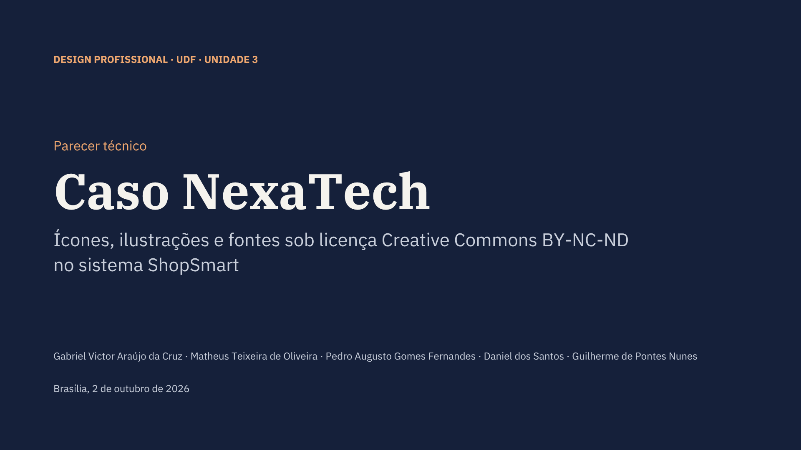

Boa noite, professor, boa noite a todos. Nós somos o grupo do Gabriel, Matheus, Pedro, Daniel e Guilherme. Hoje vamos apresentar o nosso parecer técnico sobre o caso NexaTech. A proposta é que vocês nos vejam como uma consultoria de TI que foi chamada para auditar o sistema depois que ele saiu do ar. Cada integrante apresenta uma parte e, no final, abrimos para perguntas.

## Slide 02 · Escopo da consultoria (Gabriel)

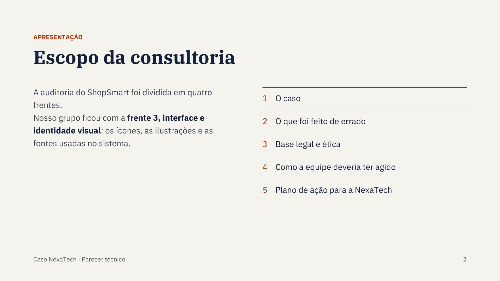

A auditoria do ShopSmart foi dividida em quatro frentes. O nosso grupo ficou com a frente 3, que trata da interface e da identidade visual, ou seja, dos ícones, das ilustrações e das fontes que foram usadas no sistema. A apresentação segue as três perguntas do parecer: o que foi feito de errado, qual é a base legal e ética e como a equipe deveria ter agido. No final a gente acrescentou um plano de ação, porque uma consultoria não para no diagnóstico. Ela precisa dizer ao cliente o que fazer agora.

## Slide 03 · O colapso da NexaTech (Gabriel)

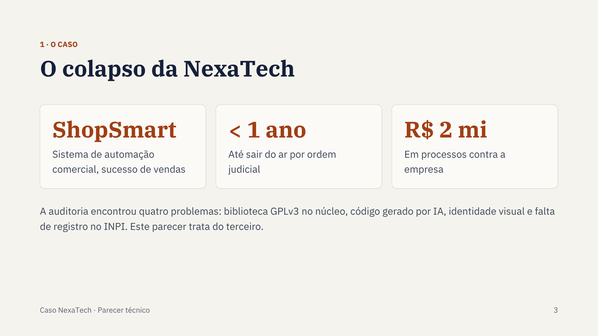

Para contextualizar: a NexaTech era uma startup de TI que criou o ShopSmart, um sistema de automação comercial. O produto vendeu bem, mas em menos de um ano foi retirado do mercado por ordem judicial, e hoje a empresa responde a processos que somam cerca de dois milhões de reais. A auditoria encontrou quatro problemas diferentes: uma biblioteca GPLv3 usada dentro de um software fechado, código gerado por IA com trechos de concorrentes, a identidade visual e a falta de registro do software no INPI. Esses dois milhões são o total dos processos, não só da nossa parte. A partir daqui o Matheus explica o que aconteceu na identidade visual.

## Slide 04 · O que foi feito de errado (Matheus)

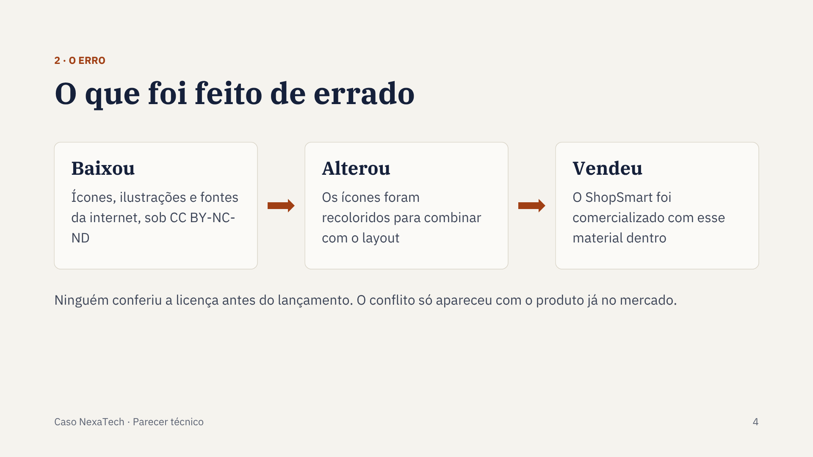

Obrigado, Gabriel. O designer da equipe baixou da internet ícones, ilustrações e um pacote de fontes, e todo esse material tinha a licença Creative Commons BY-NC-ND. Depois disso aconteceram duas coisas. Os ícones foram recoloridos para combinar com o layout do sistema, e o ShopSmart foi vendido com esse material dentro. O erro de fundo foi que ninguém conferiu a licença de cada arquivo antes do lançamento. A equipe tratou o que estava disponível na internet como se fosse livre, e o problema só apareceu quando o produto já estava no mercado.

## Slide 05 · A licença, sigla por sigla (Matheus)

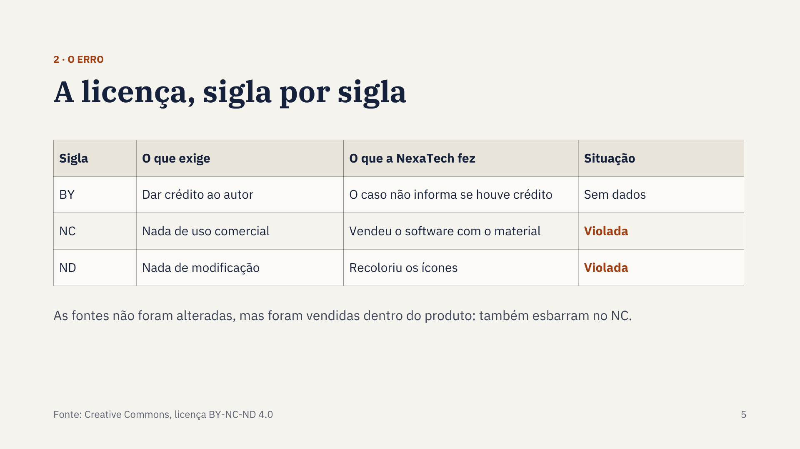

Para entender por que isso é grave, vale ler a licença sigla por sigla. BY exige dar crédito ao autor. O caso não diz se houve crédito ou não, então a gente não vai afirmar nada sobre isso. NC proíbe o uso comercial, e o ShopSmart era vendido, então essa condição foi descumprida. ND só permite distribuir cópias exatas, sem alteração, e os ícones foram recoloridos. As fontes não foram modificadas, mas foram distribuídas dentro de um produto vendido, então também esbarram no NC. Se alguém quiser discutir se trocar a cor é ou não uma modificação, a violação do NC sozinha já bastaria.

## Slide 06 · Descumpriu uma condição, perdeu a licença. (Matheus)

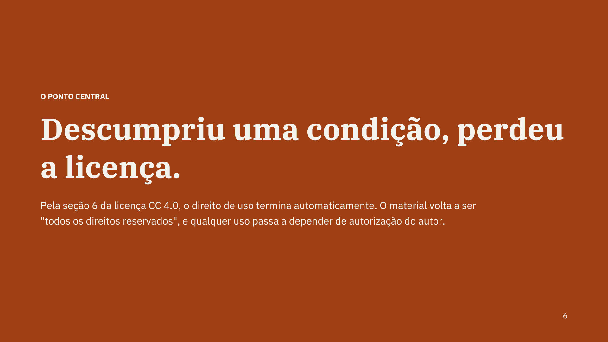

Esse é o ponto central do parecer. A licença Creative Commons não é uma autorização geral, é uma autorização com condições. Pela seção 6 da versão 4.0, quem descumpre uma condição perde a licença automaticamente. Então a NexaTech não estava só usando o material de um jeito errado: estava usando material sem autorização nenhuma. A partir daí vale a regra geral do direito autoral, e quem mostra essa base legal é o Pedro.

## Slide 07 · Lei de Direitos Autorais (Lei 9.610/98) (Pedro)

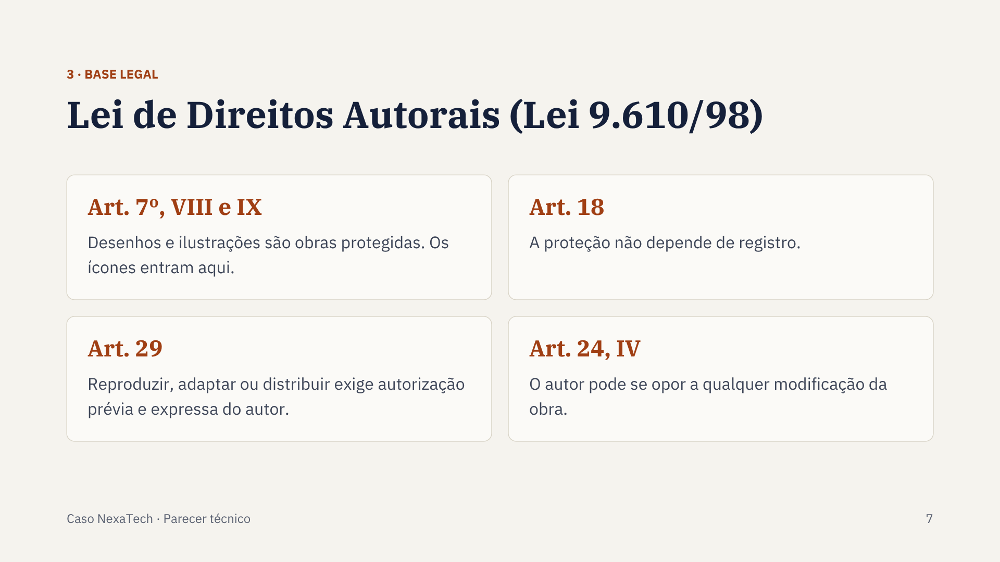

Obrigado, Matheus. A base legal está na Lei 9.610 de 1998, a Lei de Direitos Autorais. O artigo 7º lista as obras protegidas, e os incisos oito e nove incluem desenhos e ilustrações. Os ícones entram aí. O artigo 18 diz que essa proteção não depende de registro, então não importa se o autor registrou os ícones em algum lugar. O artigo 29 é o mais importante para o caso: qualquer uso da obra, como reproduzir, adaptar ou distribuir, depende de autorização prévia e expressa do autor. E o artigo 24, inciso quatro, garante ao autor o direito de se opor a modificações na obra, que é justamente o que aconteceu com a troca de cor.

## Slide 08 · Por que o sistema saiu do ar (Pedro)

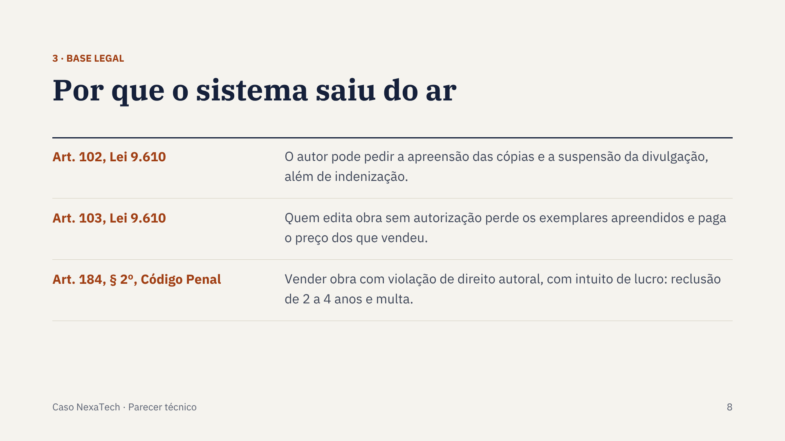

A mesma lei explica por que o sistema saiu do ar. O artigo 102 permite que o autor peça a apreensão das cópias e a suspensão da divulgação, sem prejuízo da indenização. É esse tipo de pedido que leva a ordens judiciais como as que tiraram o ShopSmart do mercado. O artigo 103 diz que quem edita uma obra sem autorização perde os exemplares apreendidos e ainda paga ao autor o preço dos que já vendeu. E existe a esfera penal: o artigo 184 do Código Penal, no parágrafo segundo, prevê reclusão de dois a quatro anos e multa para quem vende obra com violação de direito autoral com intuito de lucro. Agora o Daniel apresenta a parte ética.

## Slide 09 · Códigos de ética profissional (Daniel)

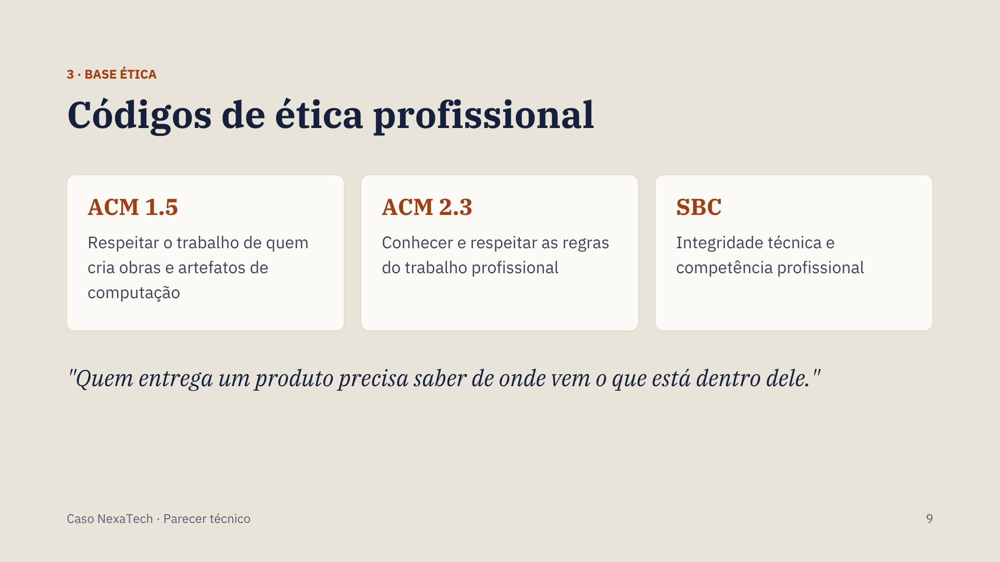

Obrigado, Pedro. Além da lei, existe a responsabilidade profissional. O Código de Ética da ACM, no princípio 1.5, pede que o profissional respeite o trabalho de quem cria ideias, obras e artefatos de computação. O princípio 2.3 pede que ele conheça e respeite as regras do próprio trabalho. O código da SBC vai na mesma linha quando fala em integridade técnica e competência profissional. Para o nosso grupo isso se resume na frase do slide: quem entrega um produto precisa saber de onde vem o que está dentro dele. Não dá para alegar que não sabia, porque conferir a origem do material faz parte do trabalho.

## Slide 10 · Como a equipe deveria ter agido (Daniel)

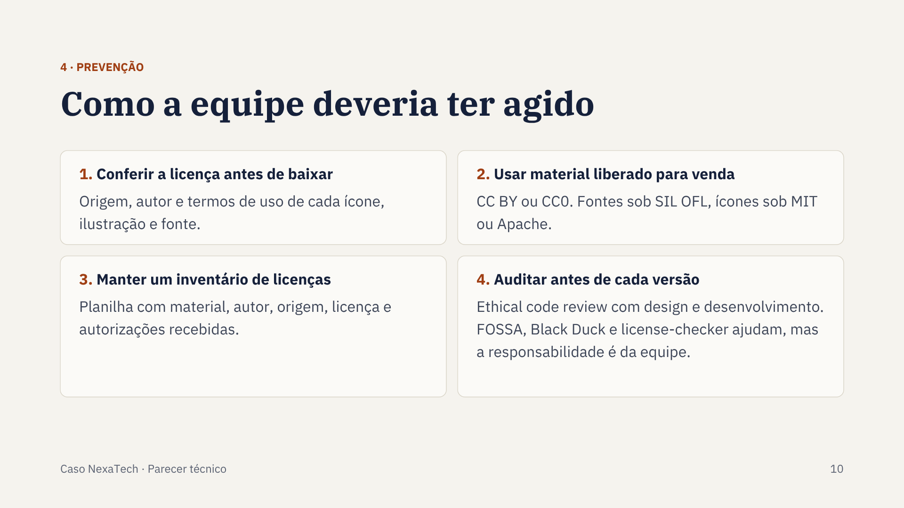

Então, como a equipe deveria ter agido? Primeiro, conferindo a licença antes de baixar qualquer material: origem, autor e termos de uso. Com esses ícones, a própria sigla já mostrava que eles não podiam ser vendidos nem alterados. Segundo, escolhendo material que permite venda e modificação, como CC BY, CC0, fontes sob a licença SIL Open Font e ícones sob MIT ou Apache. O buscador Openverse, por exemplo, deixa filtrar por uso comercial e por permissão de modificação. Terceiro, mantendo um inventário de licenças, uma planilha simples com o nome do material, autor, origem, licença e autorizações recebidas. E quarto, auditando antes de cada versão. A apostila recomenda a auditoria de licenças e cita ferramentas como FOSSA, Black Duck e license-checker, mas lembra que a responsabilidade continua sendo da equipe. Essa conferência não pode ficar só com o designer. O time de desenvolvimento tem que participar, dentro do ethical code review.

## Slide 11 · Plano de ação para a NexaTech (Guilherme)

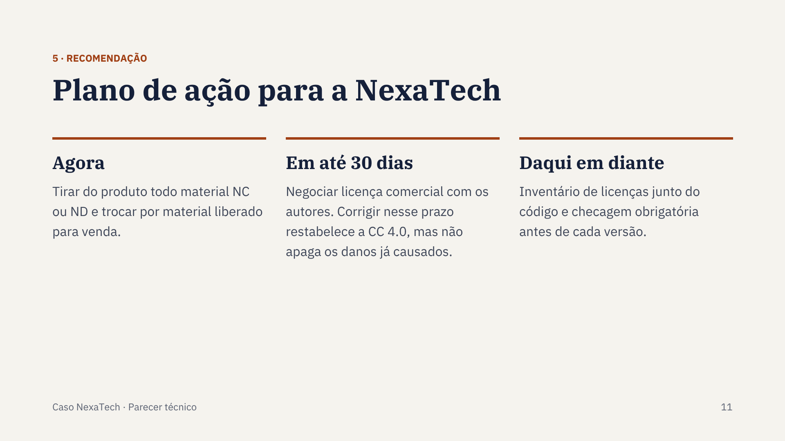

Obrigado, Daniel. Como consultoria, a nossa recomendação para a NexaTech hoje tem três etapas. Agora, tirar do produto todo ícone, ilustração e fonte com licença NC ou ND e substituir por material liberado para uso comercial. Em até trinta dias, procurar os autores para negociar uma licença comercial ou um acordo. A versão 4.0 da Creative Commons prevê que, se a violação for corrigida em até trinta dias depois de descoberta, a licença volta a valer. Mas isso não apaga o que o autor já pode cobrar pelo período anterior. E daqui em diante, manter o inventário de licenças junto com o código e tornar a checagem obrigatória antes de cada nova versão.

## Slide 12 · Licença é requisito do projeto. (Guilherme)

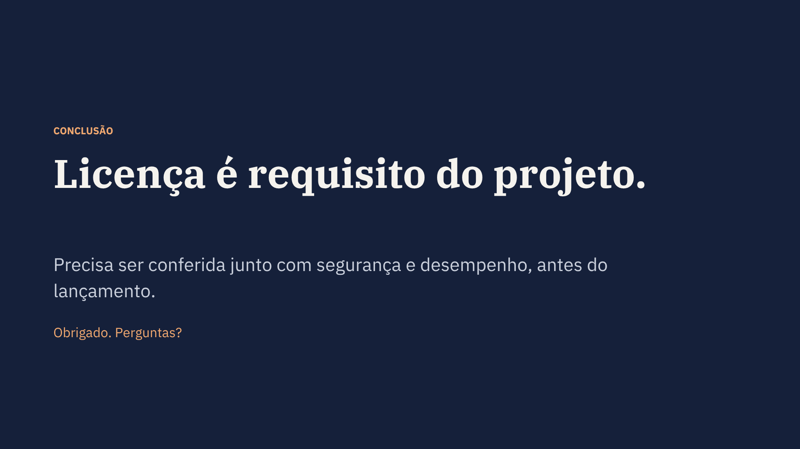

Para fechar: o caso NexaTech mostra que licença é requisito do projeto, assim como segurança e desempenho. Não é um detalhe jurídico para resolver depois do lançamento. Um pacote de ícones baixado sem conferir a licença já foi suficiente para colocar a empresa em risco. Agradecemos a atenção e ficamos à disposição para perguntas.

## Slide 13 · ASSOCIATION FOR COMPUTING MACHINERY. ACM Code of Ethics and Professional Conduct. New York: ACM, 2018. Disponível em: https://www.acm.org/code-of-ethics. Acesso em: 27 set. 2026.

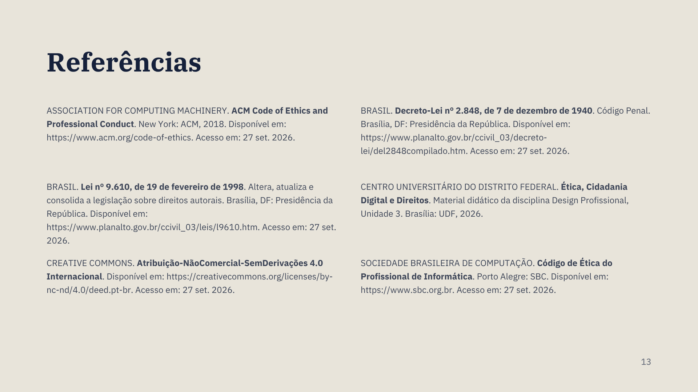

Slide de apoio. Deixar na tela durante as perguntas, se o professor pedir as fontes.
